

# دليل البدء السريع لصاحب المتجر

دليل قصير يشرح لوحة إدارة Shubayr خطوة بخطوة: من أول دخول إلى أول طلب. كل قسم بضع خطوات وصورة من اللوحة نفسها.

- **قائمة اليوم الأول للطباعة:** [first-day-checklist.ar.md](first-day-checklist.ar.md)
- **English version:** [en.md](en.md)

**المحتويات**

1. [أول دخول وتغيير كلمة المرور](#1-أول-دخول-وتغيير-كلمة-المرور)
2. [الأقسام والعلامات التجارية](#2-الأقسام-والعلامات-التجارية)
3. [إضافة منتج](#3-إضافة-منتج)
4. [المخزون الافتتاحي](#4-المخزون-الافتتاحي)
5. [التعديل الجماعي في قائمة المنتجات](#5-التعديل-الجماعي-في-قائمة-المنتجات)
6. [الاستيراد من Excel ورفع الصور دفعة واحدة](#6-الاستيراد-من-excel-ورفع-الصور-دفعة-واحدة)
7. [مناطق التوصيل والمحافظات والخصومات التلقائية](#7-مناطق-التوصيل-والمحافظات-والخصومات-التلقائية)
8. [تأكيد الطلب](#8-تأكيد-الطلب)
9. [الموظفون والصلاحيات](#9-الموظفون-والصلاحيات)

---

## 1. أول دخول وتغيير كلمة المرور

1. افتح رابط لوحة الإدارة واكتب **اسم المستخدم** و**كلمة المرور المؤقتة** اللذين وصلاك.
2. تطلب اللوحة تغيير كلمة المرور فورًا. اكتب المؤقتة، ثم كلمة جديدة تحقق كل الشروط الظاهرة (تتحول إلى اللون الأخضر)، ثم أعدها للتأكيد.
3. بعد الحفظ تفتح **الرئيسية** وفيها قائمة «ابدأ متجرك» بخطوات اليوم الأول.

> لتغيير اللغة اضغط **English** في أعلى الصفحة.

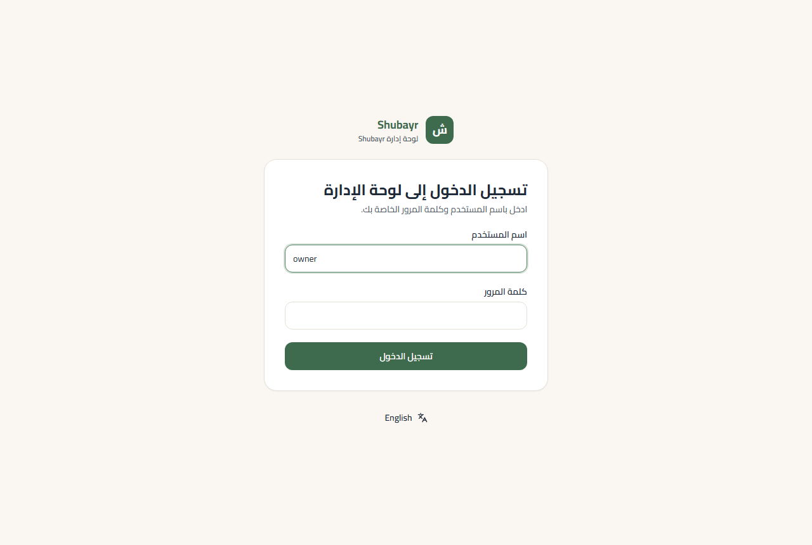

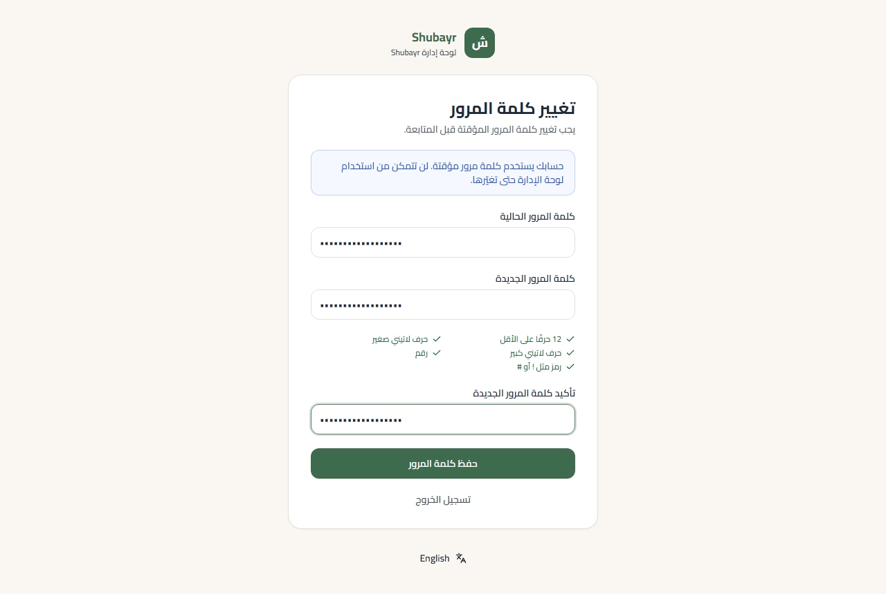

## 2. الأقسام والعلامات التجارية

الأقسام مستويان فقط: **قسم رئيسي** (مثل «إلكترونيات») وتحته **أقسام فرعية** (مثل «هواتف»). المنتجات توضع في الأقسام الفرعية.

1. من القائمة: **الأقسام ← قسم رئيسي جديد**. يكفي الاسم بالعربية؛ الاسم الإنجليزي اختياري.
2. بجانب القسم الرئيسي اضغط **قسم فرعي** وأضف أقسامه.
3. من **العلامات التجارية ← علامة تجارية جديدة** أضف العلامات (مثل «سامسونج»). يمكنك أيضًا إضافة علامة من داخل صفحة المنتج مباشرة.

> «المعرّف في الرابط» يُنشأ تلقائيًا تحت «خيارات متقدمة»؛ لا حاجة لتغييره.

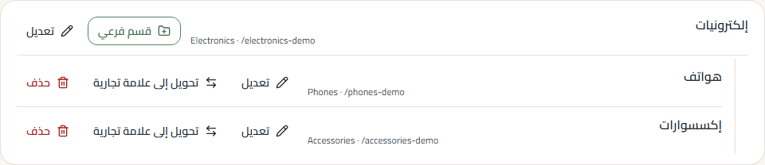

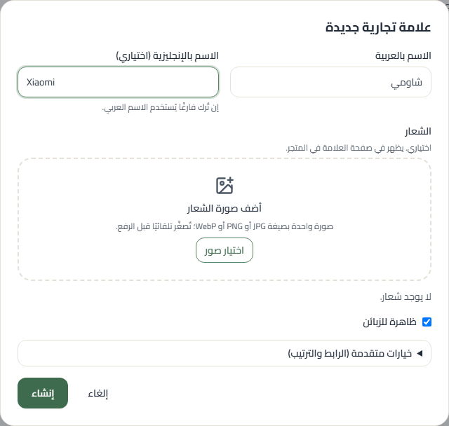

## 3. إضافة منتج

1. **المنتجات ← منتج جديد**: الاسم، القسم الفرعي، العلامة، **سعر البيع**، والوصف.
2. **الصور:** اسحب عدة صور مرة واحدة أو اضغط «اختيار صور». تُصغَّر تلقائيًا قبل الرفع. **الصورة الأولى هي الرئيسية**: اسحب أي صورة من المقبض لتغيير الترتيب، أو اضغط النجمة لجعلها الرئيسية.
3. **الأنواع والأسعار:** لكل نوع (لون، مقاس…) خاصية مثل «اللون = أسود». «إضافة نوع» ينسخ إعدادات النوع السابق، و«توليد الرموز الفارغة» يكتب رموز SKU تلقائيًا. اترك «سعر خاص» فارغًا ليأخذ النوع سعر المنتج.
4. **الظهور في المتجر:** «ظاهر في المتجر» ليراه الزبائن، أو «مخفي (مسودة)» حتى يكتمل.
5. اضغط **إنشاء المنتج**، أو **إنشاء وإضافة منتج آخر** لمنتج جديد في القسم نفسه.

**نسخ منتج:** لإضافة منتج مشابه بسرعة اضغط **نسخ المنتج** في صفحته (أو أيقونة النسخ في القائمة). تُنسخ الصور والأنواع والأسعار، وتُزاد الرموز برقم، وتبدأ النسخة مخفية.

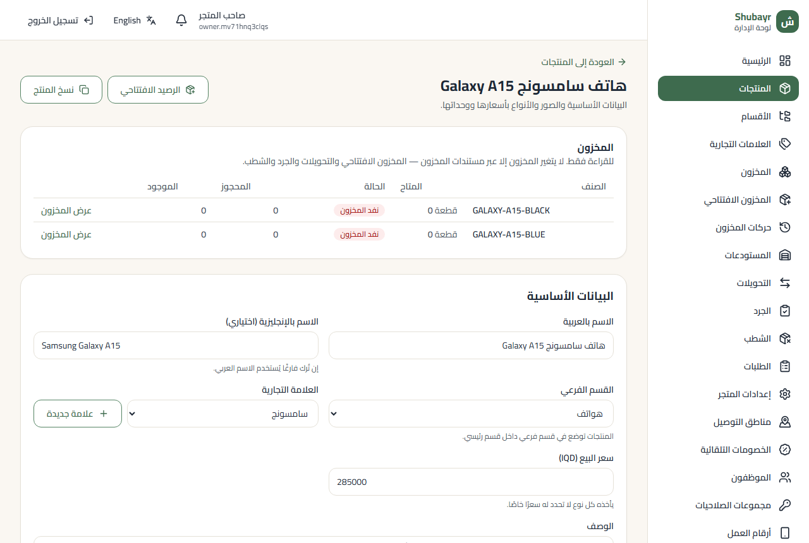

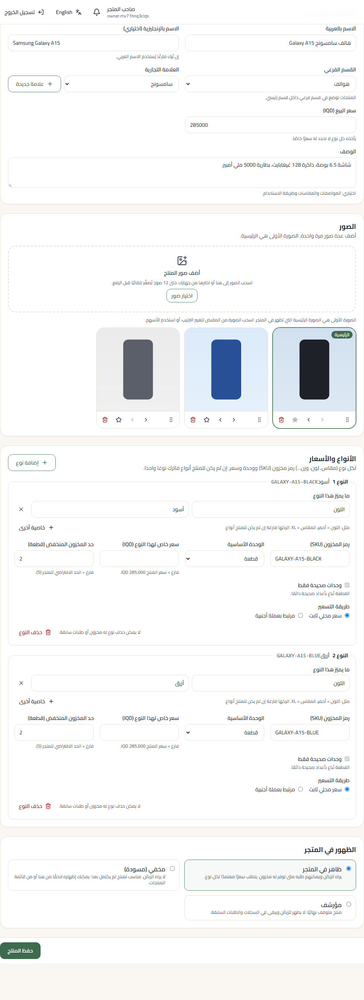

## 4. المخزون الافتتاحي

المنتج لا يظهر متوفرًا للزبائن حتى يُدخل له مخزون.

1. من صفحة المنتج اضغط **الرصيد الافتتاحي**. يفتح النموذج وفيه سطر لكل نوع.
2. لكل سطر: الموقع (يُختار تلقائيًا إن كان لديك موقع واحد)، **الكمية**، و**كلفة الوحدة**.
3. اضغط **مراجعة** ثم **ترحيل المخزون الافتتاحي**. يُرحّل المستند مرة واحدة فقط.

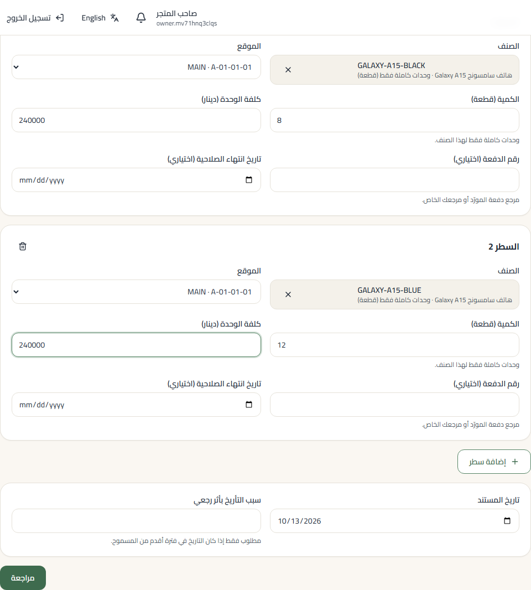

## 5. التعديل الجماعي في قائمة المنتجات

1. في **المنتجات** صفِّ حسب القسم أو العلامة أو **الحالة** أو **المخزون**، أو ابحث بالاسم.
2. حدّد المنتجات (أو كل الصفحة من مربع العنوان).
3. من الشريط الذي يظهر: **إظهار في المتجر**، **إخفاء**، **نقل إلى قسم**، أو **تغيير العلامة**. ما يتعذّر تعديله يُذكر باسمه ويبقى محددًا.

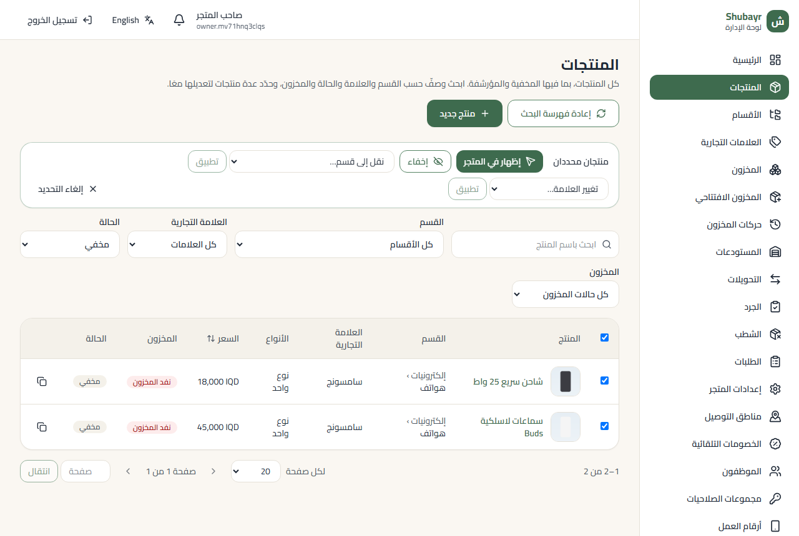

## 6. الاستيراد من Excel ورفع الصور دفعة واحدة

> **قريبًا.** يُكمَل هذا القسم بعد إطلاق شاشات الاستيراد (ملف Excel للمنتجات، ثم رفع الصور دفعة واحدة وربطها بالمنتجات). حتى ذلك الحين أضف المنتجات من «منتج جديد» واستخدم **نسخ المنتج** للمنتجات المتشابهة.

## 7. مناطق التوصيل والمحافظات والخصومات التلقائية

**مناطق التوصيل** (من **مناطق التوصيل** في القائمة):

1. **منطقة جديدة**: الاسم، **رسوم التوصيل**، والمحافظات التي تخدمها.
2. المحافظة الواحدة تتبع منطقة واحدة فقط؛ تُظهر القائمة منطقة كل محافظة الآن.
3. التحذير في الأعلى يسمّي المحافظات التي لا توصيل إليها؛ الزبون فيها لا يستطيع إتمام الطلب.
4. تبويب **المحافظات**: الأسماء بالعربية والإنجليزية، وإخفاء محافظة من عناوين الزبائن.

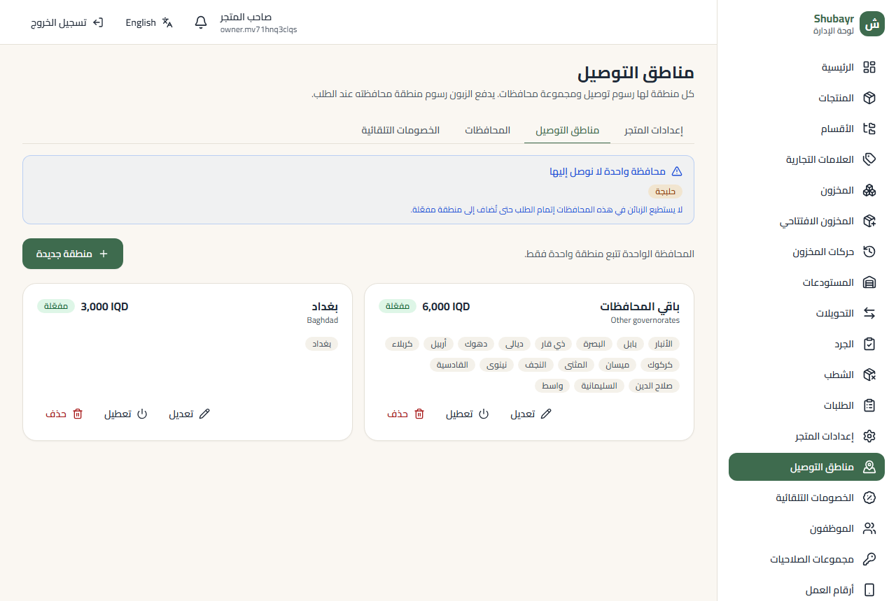

**الخصومات التلقائية** (من **الخصومات التلقائية**):

1. **مستوى جديد**: الحد الأدنى لقيمة البضاعة والنسبة، مثل «من 150,000 د.ع خصم 5٪». يظهر مثال حيّ بمقدار الخصم.
2. يُطبّق أعلى مستوى يبلغه الطلب، على البضاعة فقط دون التوصيل، ولا يُجمع مع القسائم (يحصل الزبون على الأكبر).
3. يرى الزبون في السلة: «أضف 15,000 د.ع أخرى لتحصل على خصم 10٪».

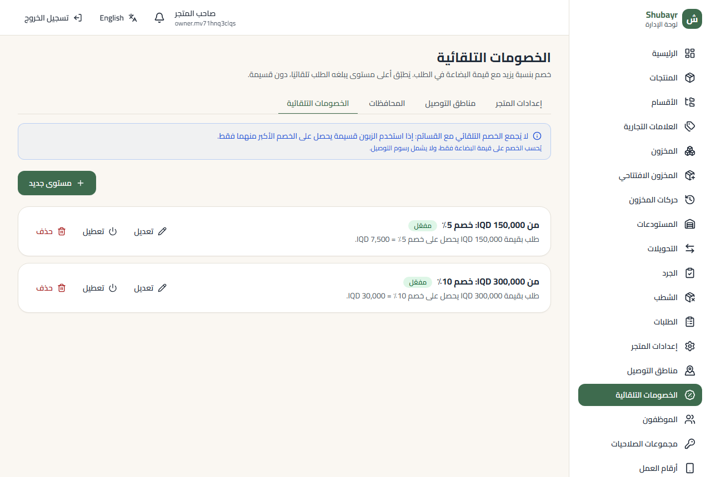

## 8. تأكيد الطلب

اتصل بالزبون قبل تأكيد كل طلب.

1. افتح الطلب من **الطلبات** واضغط **قبول الطلب**.
2. أشّر على **اتصلت بالزبون هاتفياً وأكدت هذا الطلب** واكتب ملاحظة قصيرة بما أكده.
3. لتغيير رسوم التوصيل (لمن يملك الصلاحية): اكتب الرسوم الجديدة وسببها. تظهر الرسوم **القديمة ← الجديدة** والإجمالي الجديد قبل التأكيد، ويُبلَّغ الزبون بالإجمالي الجديد.
4. اضغط **قبول الطلب** في النافذة.

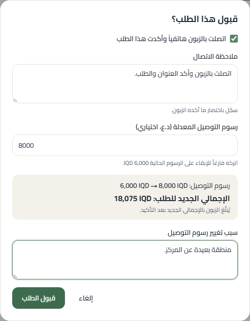

## 9. الموظفون والصلاحيات

1. **الموظفون ← موظف جديد**: اسم المستخدم والاسم الكامل وكلمة مرور مؤقتة (زر **توليد كلمة مرور** يكتب واحدة قوية).
2. اختر **مجموعة صلاحيات** جاهزة تناسب عمله، مثل `catalog_editor` (إدخال المنتجات) أو `stock_controller` (المخزون) أو `cashier`، وأضف صلاحيات إضافية عند الحاجة. `super_admin` لصاحب المتجر فقط.
3. اكتب سبب الإنشاء واحفظ. يغيّر الموظف كلمة المرور عند أول دخول.
4. لإيقاف موظف: افتح حسابه واضغط **تعطيل الحساب**؛ لا يُحذف شيء من سجله.

> صلاحية «تغيير رسوم التوصيل عند التأكيد» تُمنح فقط لمن تثق به.

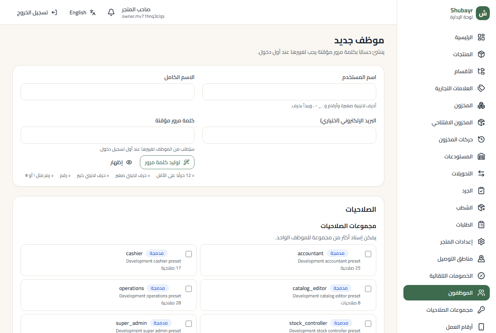

---

الصور من لوحة الإدارة الحقيقية ببيانات تجريبية. لتحديثها: `cd admin && ADMIN_DOCS_API=<رابط API تجريبي> npm run docs:screenshots` (يستخدم قاعدة بيانات تجريبية).

