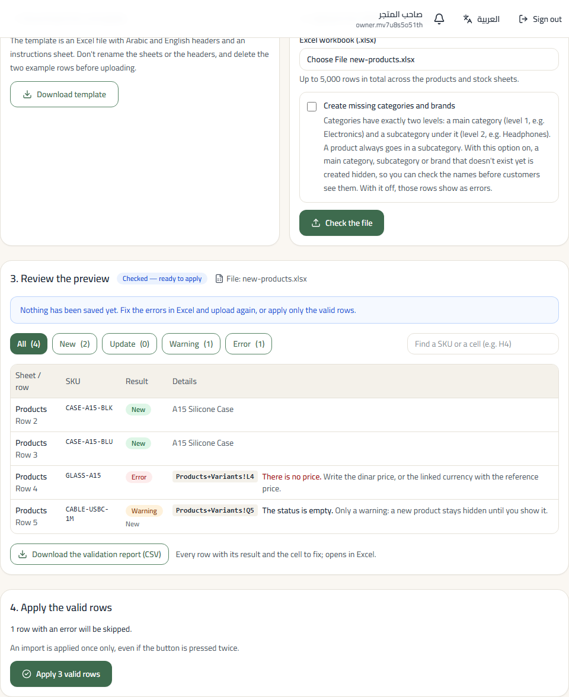
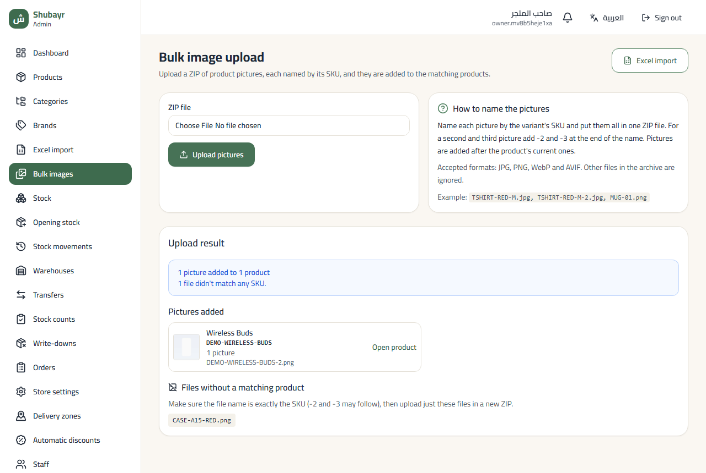

# Owner quick-start guide

A short, step-by-step tour of the Shubayr Web Admin, from the first sign-in to the first order. Each section is a few steps and one picture of the admin itself.

- **Printable first-day checklist:** [first-day-checklist.en.md](first-day-checklist.en.md)
- **النسخة العربية:** [ar.md](ar.md)

**Contents**

1. [First sign-in and changing the password](#1-first-sign-in-and-changing-the-password)
2. [Categories and brands](#2-categories-and-brands)
3. [Adding a product](#3-adding-a-product)
4. [Opening stock and restocking](#4-opening-stock-and-restocking)
5. [Bulk actions in the product list](#5-bulk-actions-in-the-product-list)
6. [Excel import and bulk images](#6-excel-import-and-bulk-images)
7. [Delivery zones, governorates and automatic discounts](#7-delivery-zones-governorates-and-automatic-discounts)
8. [Confirming and delivering an order](#8-confirming-and-delivering-an-order)
9. [Staff and permissions](#9-staff-and-permissions)

---

## 1. First sign-in and changing the password

1. Open the admin link and enter the **username** and **temporary password** you were given.
2. The admin asks you to change the password straight away: type the temporary one, then a new one that meets every rule shown (each turns green), then repeat it.
3. Once saved, the **Dashboard** opens with a "Set up your store" checklist for day one.

> To switch language, use **العربية** at the top of the page.

## 2. Categories and brands

Categories have exactly two levels: a **department** (such as "Electronics") and its **subcategories** (such as "Phones"). Products go into subcategories.

1. **Categories → New department.** The Arabic name is enough; the English name is optional.
2. Next to the department, press **Subcategory** to add its subcategories.
3. **Brands → New brand** adds brands (such as "Samsung"). You can also add a brand from the product page itself.

> The link slug is made automatically, under "Advanced"; there is no need to change it.

## 3. Adding a product

1. **Products → New product:** name, subcategory, brand, **selling price** and description.
2. **Pictures:** drop several at once or press "Choose pictures"; they are shrunk before uploading. **The first picture is the main one** — drag a picture by its handle to reorder, or press its star to make it main.
3. **Variants and prices:** each variant (colour, size…) has an attribute such as "Colour = Black". "Add variant" copies the previous variant's settings, and "Fill in empty codes" writes the SKU codes for you. Leave "Own price" empty to use the product price.
4. **Visibility in the store:** "In the store" for customers to see it, or "Hidden (draft)" until it is ready.
5. Press **Create product**, or **Create and add another** for the next product in the same category.

**Duplicate:** for a similar product, press **Duplicate** on its page (or the copy icon in the list). Pictures, variants and prices are copied, codes are moved on by one, and the copy starts hidden.

## 4. Opening stock and restocking

A product shows as available only once it has stock. There are two ways in, for two different moments.

**Opening stock (first time only)** — the stock you already have on your first day.

1. On the product page, press **Opening stock (first time only)**. The form opens with a line per variant.
2. For each line you have: the location (chosen for you when you have only one), the **quantity** and the **unit cost**. A line you leave without a quantity is skipped — you don't have to delete it (a button removes the empty lines if you prefer).
3. Press **Review**: it lists only the lines that will be posted. Then **Post opening stock**. The document posts exactly once.

**Restock** — stock you buy later, from a supplier. Never use opening stock for this: restocking is a purchase, so it records what you paid and what you owe.

1. On the product page (or on its row in **Stock**), press **Restock**. Once the product has stock, this is the main button.
2. The purchase invoice opens with a line per variant, each starting at what you last paid, today's date and your usual location. Enter the quantity you received **only on the lines you restock** — to restock just the red one, fill only the red line; the others stay empty and are left out.
3. Choose the **supplier** (the ones you bought from recently come first). A new one? Press **New supplier** (the person icon next to the list): name and phone, and it is chosen.
4. **Payment:** *Owed — pay later* adds the amount to what you owe the supplier (pay it later from **Supplier payments**); *Paid now from a cash account* pays the whole invoice from the cash account you choose, right after the stock is added.
5. Press **Review**, then **Save and add to stock**. The page shows each variant's new stock, with a button back to the product.

## 5. Bulk actions in the product list

1. In **Products**, search by name, **SKU** or **barcode**, or filter by category, brand, **status**, **stock** or **picture**. Click a column title (name, SKU, price) to sort.
2. Select products (or the whole page from the header box). To include every product the filter found, press **Select all matching** — up to 500 at a time.
3. From the bar that appears: **Show in store**, **Hide**, **Move to category** or **Change brand**. The result lists each product: anything that could not be changed says why and stays selected.

## 6. Excel import and bulk images

Add many products at once from Excel, update existing ones, and enter opening stock — then add their pictures from one ZIP file. Both are in the menu, below **Brands**: **Excel import** and **Bulk images**.

**Excel import**

1. Open **Excel import** and press **Download template**. Fill in the **Products+Variants** sheet: one row per variant, with its own **SKU**. Rows with the same names, category and brand become one product with several variants. Don't rename the sheets or the headers, and delete the two example rows.
2. Categories have two levels: the main category (level 1) and the subcategory under it (level 2), where the product goes. Write the names as they appear in **Categories**.
3. Optional: fill the **Stock** sheet (SKU, location code, quantity, unit cost) to enter opening stock at the same time.
4. Choose the file and press **Check the file**. Nothing is saved yet. Large files are checked in the background with a progress bar; you can leave and reopen them from **Import history**.
5. Review the preview. Each row is **New**, **Update** (the SKU already exists), **Warning** or **Error**. Press a result to see only those rows; each error names its cell (for example `Products+Variants!L4`: column L, row 4) and how to fix it. **How to fill in the workbook** on the same page explains every column and the common errors. **Download the validation report** gives the same list as a file for Excel.
6. If categories or brands are missing, either correct the names, or tick **Create missing categories and brands** and check the file again — new ones are created hidden, so you can review them in **Categories** before customers see them.
7. Press **Apply valid rows**. Rows with errors are skipped; fix them in Excel and import them again. The import is applied once, even if the button is pressed twice. The result shows how many products were added and updated, and links to the opening-stock document when the file had a Stock sheet.

One file can hold up to 5,000 rows. A big import is applied on the server in batches, with a bar showing the rows and batches applied so far: you can leave the page or close it and come back to it from **Import history**. If a row fails while applying, the import stops there and says which row and why; the rows already applied stay applied. Fix the cause and press **Resume the import** — it continues from where it stopped.

**Bulk images**

1. Name each picture by the variant's SKU: `TSHIRT-RED-M.jpg`. For a second and third picture of the same product add `-2` and `-3`: `TSHIRT-RED-M-2.jpg`.
2. Put the pictures in one ZIP file (JPG, PNG, WebP or AVIF).
3. Open **Bulk images**, choose the ZIP and press **Upload pictures**. A bar shows the upload.
4. The result lists the pictures added to each product, with a link to it, and the files that matched no SKU. Rename those and upload them again in a new ZIP.

## 7. Delivery zones, governorates and automatic discounts

**Delivery zones** (from **Delivery zones** in the menu):

1. **New zone:** a name, the **delivery fee**, and the governorates it serves.
2. A governorate belongs to one zone only; the list shows which zone each one is in now.
3. The warning at the top names the governorates you don't deliver to; customers there cannot check out.
4. The **Governorates** tab: names in Arabic and English, and hiding a governorate from customers' addresses.

**Automatic discounts** (from **Automatic discounts**):

1. **New tier:** the minimum goods value and the percent, such as "from 150,000 IQD, 5% off". A live example shows the amount.
2. The highest tier an order reaches applies, to the goods only (never delivery), and it does not combine with coupons (the customer gets the larger one).
3. In the cart customers see: "Add 15,000 IQD more to get 10% off".

## 8. Confirming and delivering an order

Call the customer before confirming every order.

1. Open the order from **Orders** and press **Accept order**.
2. Tick **I phoned the customer and confirmed this order** and write a short note of what they confirmed.
3. To change the delivery fee (with the permission): type the new fee and the reason. The **old → new** fee and the new total show before you confirm, and the customer is told the new total.
4. Press **Accept order** in the dialog.

**Delivering it.** First add your **delivery party** once: your own driver or a courier company (**Delivery parties** → name and phone). Then, on the order:

1. **Start preparing**, then **Mark ready**.
2. Under the delivery, choose who carries it and press **Assign**, then **Hand over to agent**. If there is no delivery party yet, the order says so and takes you straight to adding one.
3. When it is delivered, press **Mark delivered** and confirm the cash the driver collected (the full amount is filled in; enter less if they collected less).
4. When the driver brings the cash, record it in **Cash receipts** → **Receive cash**: choose the driver and the cash account, then **All held** and **Auto-allocate oldest first**, review and confirm. What the driver holds for the store goes back to zero.

## 9. Staff and permissions

1. **Staff → New staff member:** username, full name and a temporary password (**Generate password** writes a strong one).
2. Choose a ready-made **permission preset** for their job, such as `catalog_editor` (entering products), `stock_controller` (stock) or `cashier`, and add extra permissions if needed. `super_admin` is for the owner only.
3. Write the reason and save. The staff member changes the password at first sign-in.
4. To stop someone's access, open their account and press **Deactivate**; nothing is deleted from their history.

> Give "change the delivery fee at confirmation" only to staff you trust.

---

Pictures are of the real admin with demo data. To refresh them: `cd admin && ADMIN_DOCS_API=<throwaway API URL> npm run docs:screenshots` (it uses a throwaway database).
