# Owner quick-start guide

A short, step-by-step tour of the Shubayr Web Admin, from the first sign-in to the first order. Each section is a few steps and one picture of the admin itself.

- **Printable first-day checklist:** [first-day-checklist.en.md](first-day-checklist.en.md)
- **النسخة العربية:** [ar.md](ar.md)

**Contents**

1. [First sign-in and changing the password](#1-first-sign-in-and-changing-the-password)
2. [Categories and brands](#2-categories-and-brands)
3. [Adding a product](#3-adding-a-product)
4. [Opening stock](#4-opening-stock)
5. [Bulk actions in the product list](#5-bulk-actions-in-the-product-list)
6. [Excel import and bulk images](#6-excel-import-and-bulk-images)
7. [Delivery zones, governorates and automatic discounts](#7-delivery-zones-governorates-and-automatic-discounts)
8. [Confirming an order](#8-confirming-an-order)
9. [Staff and permissions](#9-staff-and-permissions)

---

## 1. First sign-in and changing the password

1. Open the admin link and enter the **username** and **temporary password** you were given.
2. The admin asks you to change the password straight away: type the temporary one, then a new one that meets every rule shown (each turns green), then repeat it.
3. Once saved, the **Dashboard** opens with a "Set up your store" checklist for day one.

> To switch language, use **العربية** at the top of the page.

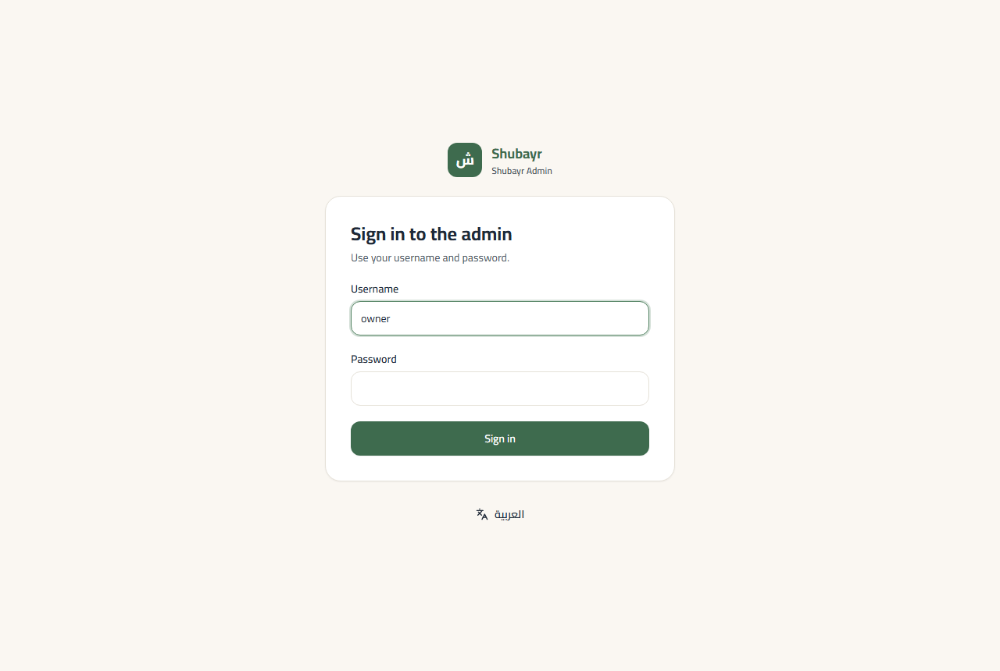

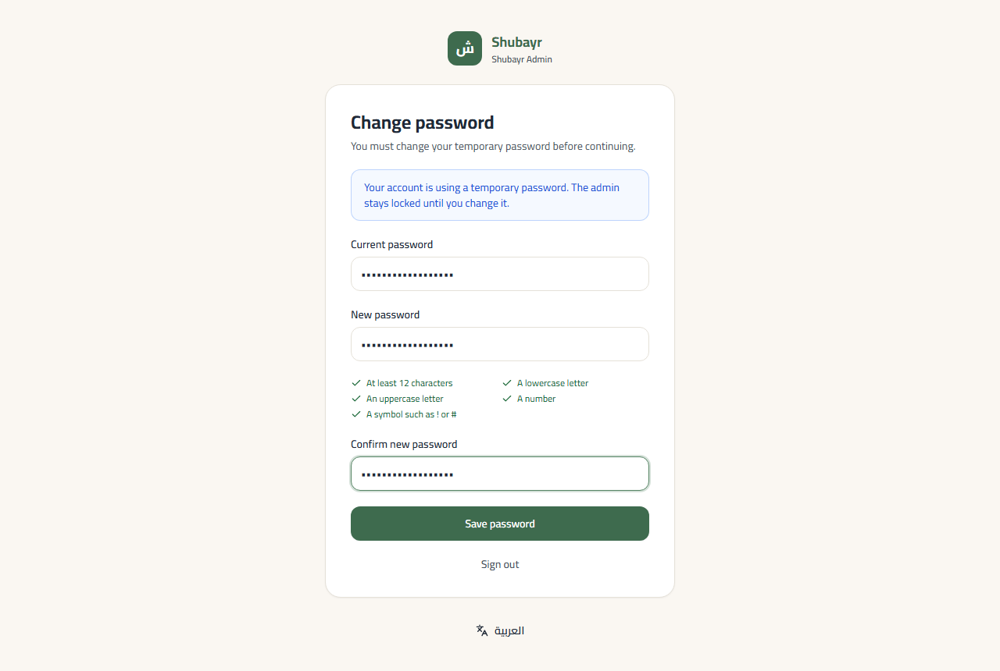

## 2. Categories and brands

Categories have exactly two levels: a **department** (such as "Electronics") and its **subcategories** (such as "Phones"). Products go into subcategories.

1. **Categories → New department.** The Arabic name is enough; the English name is optional.
2. Next to the department, press **Subcategory** to add its subcategories.
3. **Brands → New brand** adds brands (such as "Samsung"). You can also add a brand from the product page itself.

> The link slug is made automatically, under "Advanced"; there is no need to change it.

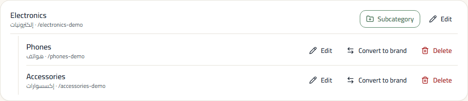

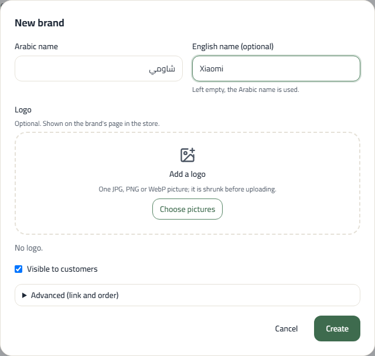

## 3. Adding a product

1. **Products → New product:** name, subcategory, brand, **selling price** and description.
2. **Pictures:** drop several at once or press "Choose pictures"; they are shrunk before uploading. **The first picture is the main one** — drag a picture by its handle to reorder, or press its star to make it main.
3. **Variants and prices:** each variant (colour, size…) has an attribute such as "Colour = Black". "Add variant" copies the previous variant's settings, and "Fill in empty codes" writes the SKU codes for you. Leave "Own price" empty to use the product price.
4. **Visibility in the store:** "In the store" for customers to see it, or "Hidden (draft)" until it is ready.
5. Press **Create product**, or **Create and add another** for the next product in the same category.

**Duplicate:** for a similar product, press **Duplicate** on its page (or the copy icon in the list). Pictures, variants and prices are copied, codes are moved on by one, and the copy starts hidden.

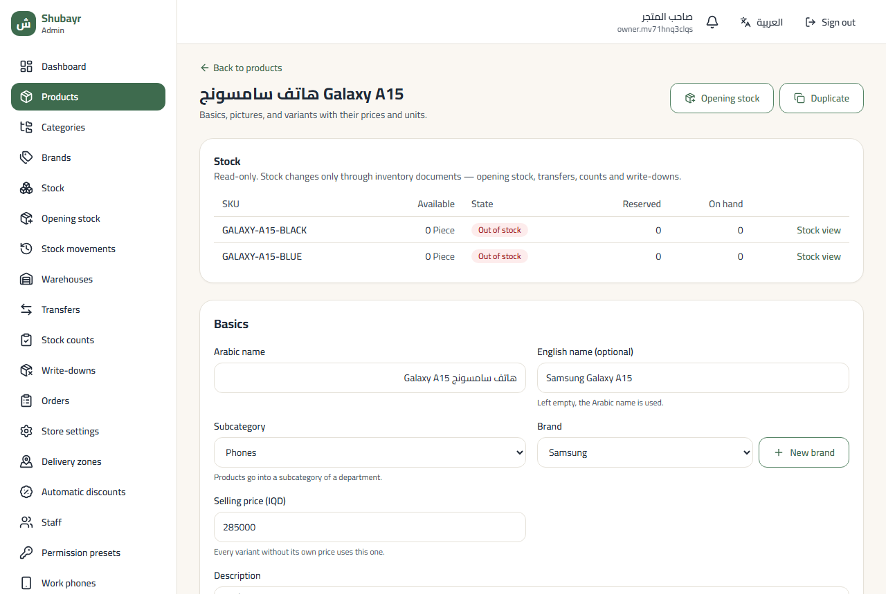

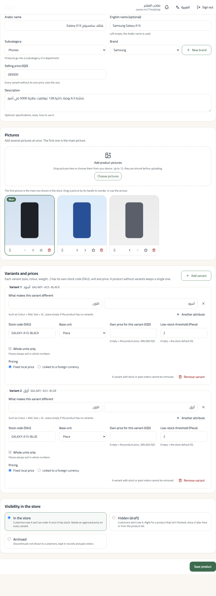

## 4. Opening stock

A product shows as available only once it has stock.

1. On the product page, press **Opening stock**. The form opens with a line per variant.
2. For each line: the location (chosen for you when you have only one), the **quantity** and the **unit cost**.
3. Press **Review**, then **Post opening stock**. The document posts exactly once.

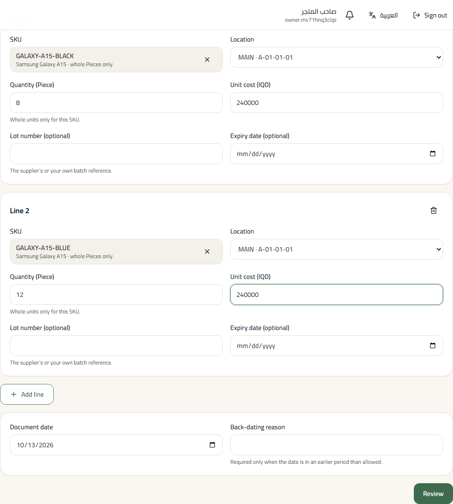

## 5. Bulk actions in the product list

1. In **Products**, filter by category, brand, **status** or **stock**, or search by name.
2. Select products (or the whole page from the header box).
3. From the bar that appears: **Show in store**, **Hide**, **Move to category** or **Change brand**. Anything that cannot be changed is named and stays selected.

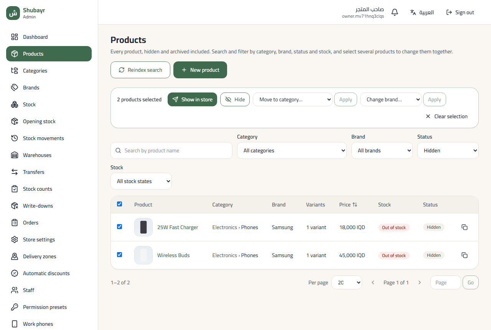

## 6. Excel import and bulk images

> **Coming soon.** This section is completed once the import screens are released (an Excel file of products, then uploading pictures in bulk and matching them to products). Until then, add products with "New product" and use **Duplicate** for similar ones.

## 7. Delivery zones, governorates and automatic discounts

**Delivery zones** (from **Delivery zones** in the menu):

1. **New zone:** a name, the **delivery fee**, and the governorates it serves.
2. A governorate belongs to one zone only; the list shows which zone each one is in now.
3. The warning at the top names the governorates you don't deliver to; customers there cannot check out.
4. The **Governorates** tab: names in Arabic and English, and hiding a governorate from customers' addresses.

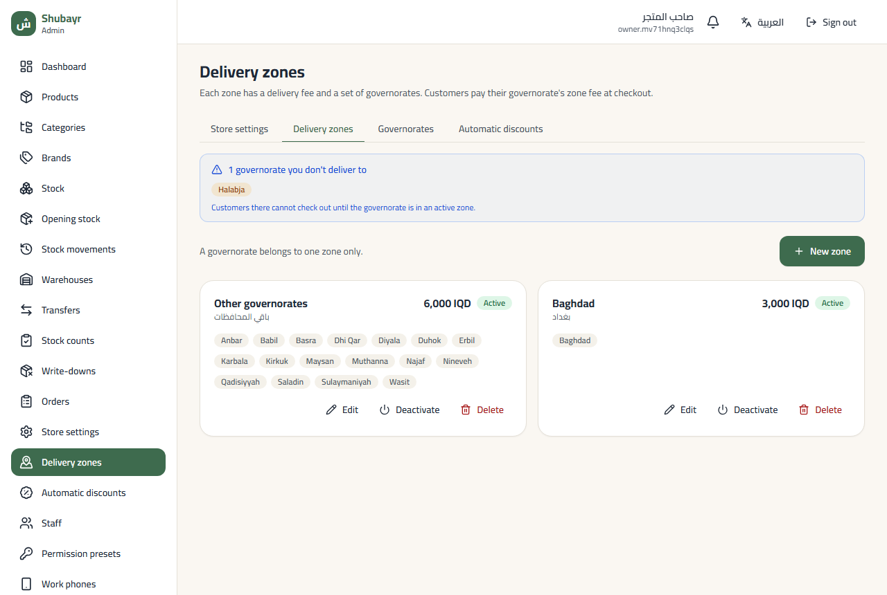

**Automatic discounts** (from **Automatic discounts**):

1. **New tier:** the minimum goods value and the percent, such as "from 150,000 IQD, 5% off". A live example shows the amount.
2. The highest tier an order reaches applies, to the goods only (never delivery), and it does not combine with coupons (the customer gets the larger one).
3. In the cart customers see: "Add 15,000 IQD more to get 10% off".

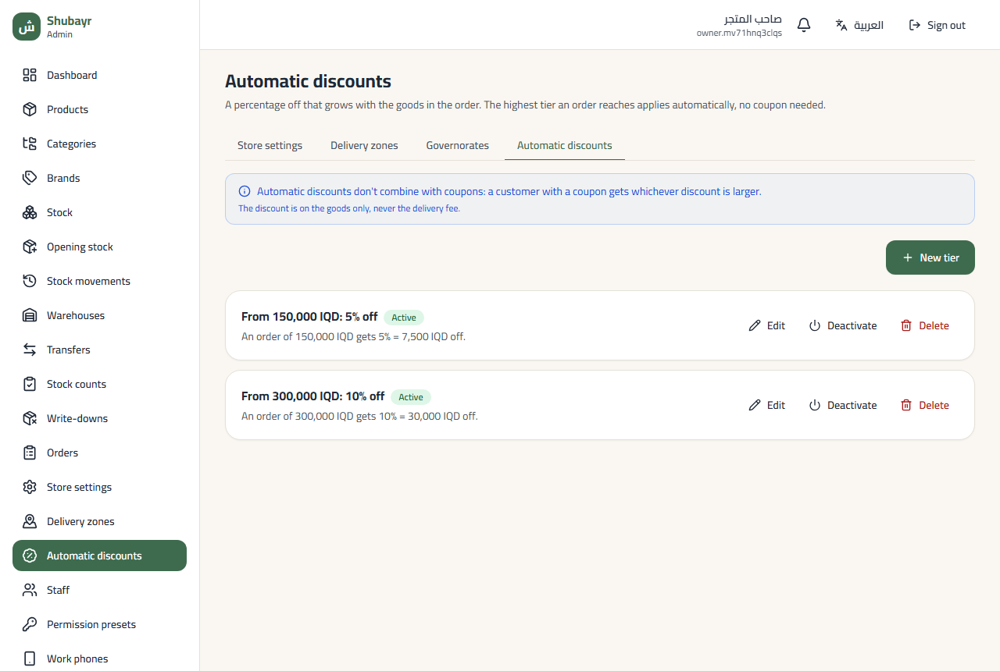

## 8. Confirming an order

Call the customer before confirming every order.

1. Open the order from **Orders** and press **Accept order**.
2. Tick **I phoned the customer and confirmed this order** and write a short note of what they confirmed.
3. To change the delivery fee (with the permission): type the new fee and the reason. The **old → new** fee and the new total show before you confirm, and the customer is told the new total.
4. Press **Accept order** in the dialog.

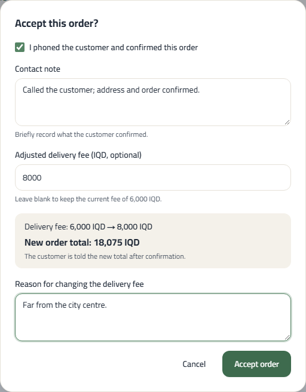

## 9. Staff and permissions

1. **Staff → New staff member:** username, full name and a temporary password (**Generate password** writes a strong one).
2. Choose a ready-made **permission preset** for their job, such as `catalog_editor` (entering products), `stock_controller` (stock) or `cashier`, and add extra permissions if needed. `super_admin` is for the owner only.
3. Write the reason and save. The staff member changes the password at first sign-in.
4. To stop someone's access, open their account and press **Deactivate**; nothing is deleted from their history.

> Give "change the delivery fee at confirmation" only to staff you trust.

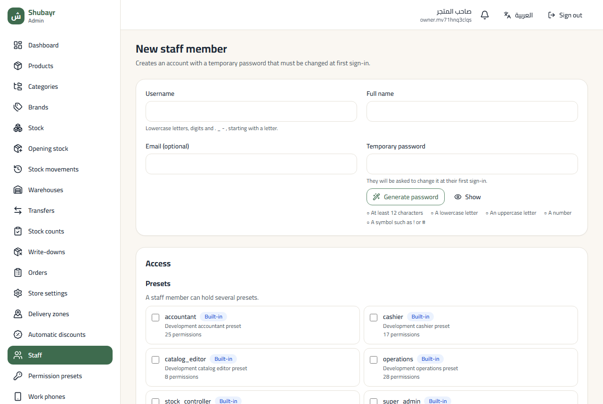

---

Pictures are of the real admin with demo data. To refresh them: `cd admin && ADMIN_DOCS_API=<throwaway API URL> npm run docs:screenshots` (it uses a throwaway database).
